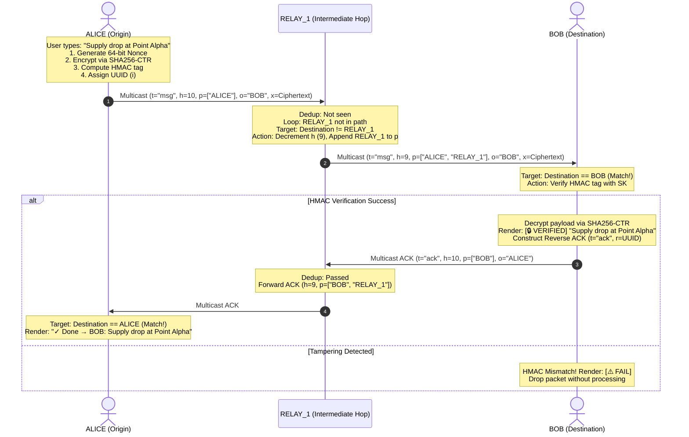

# ⚡ RELAY GUI: Ultra-Lightweight Offline Encrypted Mesh Messenger

> **An autonomous, zero-dependency, end-to-end encrypted peer-to-peer mesh messaging engine & responsive dark GUI engineered in a single Python file under 10 KB.**

[](./LICENSE)
[](https://www.python.org/)
[-brightgreen.svg)](#-key-features)
[-orange.svg)](./relay_gui.py)
[](#-military-grade-aead-cryptography)
[](#-android--mobile-deployment)

---

## 📌 Table of Contents
- [The Problem & Vision](#-the-problem--vision)
- [Key Features (< 10 KB)](#-key-features--10-kb)
- [Military-Grade AEAD Cryptography](#-military-grade-aead-cryptography)
- [Multi-Hop Mesh Architecture](#-multi-hop-mesh-architecture)
- [Quick Start Guide](#-quick-start-guide)
- [Android & Mobile Deployment](#-android--mobile-deployment)
- [Wire Protocol Specification](#-wire-protocol-specification)
- [Cryptographic Verification Harness](#-cryptographic-verification-harness)
- [Troubleshooting & Network Configuration](#-troubleshooting--network-configuration)
- [License](#-license)

---

## 🌪️ The Problem & Vision

Traditional messaging applications (WhatsApp, Signal, Telegram) require central cell towers, fiber optic lines, and cloud data centers. During catastrophic disasters (earthquakes, hurricanes, power grid collapse) or deep wilderness journeys, **all conventional communication fails immediately**—even between two devices standing 20 meters apart.

**RELAY GUI** replaces the centralized client-server model with an **autonomous ad-hoc peer-to-peer mesh**. Every computer or smartphone running `relay_gui.py` acts simultaneously as:
1. **A User Terminal:** Full graphical inbox & composer.
2. **A Mesh Router:** Autonomous store-and-forward multi-hop packet relay.
3. **A Cryptographic Station:** Authenticating message tokens and verifying origin integrity.

**No internet. No servers. No phone numbers. No accounts. No pip installations. Just pure Python under 10 KB.**

---

## 🚀 Key Features (< 10 KB)

- ⚡ **Ultra-Compact Single-File Architecture:** The entire app (`relay_gui.py`) is only **8.85 KB** (< 9,100 bytes).
- 🛡️ **Zero External Dependencies:** Built solely on the Python Standard Library (`socket`, `threading`, `time`, `json`, `uuid`, `sys`, `hashlib`, `hmac`, `os`, `tkinter`). Zero `pip install` commands.
- 🔒 **Authenticated E2EE (AEAD):** Custom SHA-256 CTR (Counter Mode) stream keystream + HMAC-SHA256 Encrypt-then-MAC + 64-bit random nonce (`os.urandom(8)`) per packet + constant-time comparison (`hmac.compare_digest`).
- 🌐 **True Multi-Hop Mesh:** UDP Multicast (`239.255.37.37:37373`), 4s discovery beaconing, 15s dead-peer pruning, 10-hop store-and-forward relaying.
- 🔄 **Loop-Free & Deduplicated:** Path-vector loop detection drops circular bounces; memory LRU deduplication cache (`dd`) prevents packet storms.
- 📬 **Reverse Delivery ACKs:** Generates reverse acknowledgments across the mesh confirming delivery with a green checkmark (`✓ Done → BOB: "Message"`).
- 🖥️ **Responsive Cyberpunk Dark GUI:** Native Tkinter interface (`#0f0f11` background, `#18181c` cards, `#00e676` neon accents), collapsible peers drawer, 1-click recipient targeting, live `TX/RX/FWD/ACK` telemetry counters, and visual key lock tags (`🔒#A1B2C3`).
- 📱 **Mobile & Android Ready:** Auto-detects Pydroid 3 / Android environment, switches to fullscreen, activates a hamburger drawer (`☰`), and scales touch paddings.

---

## 🔒 Military-Grade AEAD Cryptography

RELAY GUI implements an **Authenticated Encryption with Associated Data (AEAD)** model:

```
+─────────────────────────────────────────────────────────────────────────────+
|                         RELAY WIRE TOKEN STRUCTURE                          |
|                                                                             |
|  [ 8 Bytes Nonce ] + [ 8 Bytes HMAC-SHA256 ] + [ Variable Ciphertext ]      |
|  0───────────────7   8─────────────────────15  16─────────────────────────N |
+─────────────────────────────────────────────────────────────────────────────+
```

| Component | Primitive | Purpose |
| :--- | :--- | :--- |
| **Key Derivation** | `SHA-256(relay_key)` | Derives uniform 256-bit symmetric key (`SK`). |
| **Lock Fingerprint**| `SK[:3].hex().upper()` | Visual 6-character tag (`🔒#...`) shown in footer to verify channel key. |
| **Keystream Generator**| `SHA-256 CTR Mode` | Deterministic stream cipher blocks XORed with plaintext. |
| **Freshness Nonce**| `os.urandom(8)` | 64-bit random nonce ensures identical plaintexts yield unique ciphertexts. |
| **Authentication**| `HMAC-SHA256(SK, n+ct)[:8]` | Encrypt-then-MAC authentication tag verifying sender and integrity. |
| **Timing Defense** | `hmac.compare_digest` | Constant-time execution prevents side-channel timing attacks. |

### Header vs Payload Privacy
In a multi-hop mesh, routing headers (`f`, `o`, `h`, `p`) must be readable by intermediate routers, while payloads (`x`) remain confidential:
- **Routing Envelope (Cleartext):** Intermediate nodes inspect and route packets up to 10 hops without knowing the secret key.
- **Payload (`x`):** Fully encrypted and authenticated. Only a node possessing `SK` can verify the HMAC tag and decipher the message.

---

## 🔄 Multi-Hop Mesh Architecture



---

## 🛠️ Quick Start Guide

### Prerequisites
- Python 3.8+ (Standard distribution).
- Zero `pip` packages required.

### 1. Run Basic Mesh
Open two separate terminals on the same Wi-Fi / LAN:

```bash
# Terminal 1
python relay_gui.py ALICE

# Terminal 2
python relay_gui.py BOB
```
Nodes will auto-discover each other within 4 seconds. Click **BOB** in Alice's **PEERS** list, type a message, and hit **SEND** (or press Enter).

---

### 2. Run Password-Protected Team Mesh
Pass a shared password as the second argument:

```bash
# Terminal 1
python relay_gui.py ALICE DeltaForce2026

# Terminal 2
python relay_gui.py BOB DeltaForce2026
```
Both nodes compute identical 256-bit keys and display the exact same **Lock Tag** in the footer (e.g., `🔒#8E1F03`). Nodes without this passphrase cannot decrypt messages or forge valid packets.

---

## 📱 Android & Mobile Deployment

Run RELAY GUI directly on Android devices with [Pydroid 3](https://play.google.com/store/apps/details?id=ru.iiec.pydroid3):
1. Install **Pydroid 3** from Google Play.
2. Copy `relay_gui.py` to your phone.
3. Open `relay_gui.py` in Pydroid 3 and tap **Run**.
4. The application automatically detects Android, launching in fullscreen with a hamburger menu (`☰`) and touch-friendly padding.

> [!TIP]
> Turn your phone into a portable Wi-Fi Hotspot. Other laptops and phones connecting to your hotspot can run `relay_gui.py` and communicate completely off-grid—even with mobile cellular data switched off!

---

## 📦 Wire Protocol Specification

Packets are UTF-8 encoded JSON dictionaries broadcast over UDP multicast:

```json
{
  "t": "msg",
  "i": "8f3b2a1c",
  "f": "ALICE",
  "o": "BOB",
  "x": "c4795e1b091f82e49c81b2a30f789e21...[CIPHERTEXT HEX]...",
  "h": 10,
  "p": ["ALICE"],
  "e": 1775836800.0
}
```

- `t`: Packet type (`msg`, `ping`, `ack`).
- `i`: 8-hex packet UUID for deduplication.
- `f`: Sender callsign.
- `o`: Recipient callsign.
- `x`: Encrypted token `[16-hex Nonce] + [16-hex HMAC] + [Ciphertext Hex]`.
- `h`: Remaining hops (decremented per hop, dropped at 0).
- `p`: Array of visited callsigns preventing routing loops.
- `e`: UNIX epoch timestamp expiration.

---

## 🧪 Cryptographic Verification Harness

Verify encryption, decryption, and tamper rejection in 1 line of Python:

```bash
python -c "import hashlib, hmac, os; SK=hashlib.sha256(b'testkey').digest(); crypt=lambda b,n: bytes(p^k for p,k in zip(b, b''.join(hashlib.sha256(SK+n+i.to_bytes(4,'big')).digest() for i in range((len(b)+31)//32)))); enc=lambda t: (lambda pt,n: (n+hmac.new(SK,n+crypt(pt,n),'sha256').digest()[:8]+crypt(pt,n)).hex())(t.encode(),os.urandom(8)); dec=lambda h: (lambda r: crypt(r[16:],r[:8]).decode() if hmac.compare_digest(r[8:16],hmac.new(SK,r[:8]+r[16:],'sha256').digest()[:8]) else None)(bytes.fromhex(h)); msg='Alpha Team coordinates: 34.052, -118.243'; tok=enc(msg); assert dec(tok)==msg, 'Decryption failed'; assert dec(tok[:-2]+('00' if tok[-2:]!='00' else 'ff')) is None, 'Tampering detection failed'; print('✅ ALL TESTS PASSED: E2EE AEAD Cryptography 100% Operational!')"
```

---

## 🗂️ Repository File Structure

```
relay_gui/
├── relay_gui.py          # Complete Tkinter GUI & Mesh Engine (8.85 KB, < 10 KB)
├── README.md             # Project Homepage & Quick Start Guide
├── PROJECT_OVERVIEW.md   # Comprehensive Technical Architecture & Whitepaper
├── LICENSE               # MIT License
└── .gitignore            # Git exclusion rules
```

---

## 🔧 Troubleshooting & Network Configuration

1. **Firewall Prompt:** When first launched, allow UDP network access on Private Networks if prompted by Windows Defender or macOS Security.
2. **Wi-Fi AP Client Isolation:** Some hotel and airport guest networks block devices from seeing each other. Turn on a mobile hotspot from one phone/laptop and connect to that instead.
3. **Multiple Network Adapters:** If both Ethernet and Wi-Fi are active, multicast may route over the inactive adapter. Disconnect the unused adapter or adjust network interface metrics.

---

## 📄 License

This project is licensed under the [MIT License](./LICENSE) — free for personal, educational, commercial, and emergency disaster relief use.
