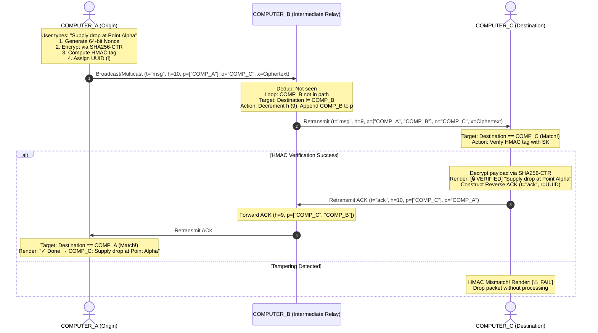

# ⚡ RELAY GUI: Ultra-Lightweight Offline Encrypted Mesh Messenger

> **An autonomous, zero-dependency, end-to-end encrypted peer-to-peer mesh messaging engine & responsive dark GUI engineered in a single Python file under 10 KB for offline computer-to-computer communications.**

[](./LICENSE)
[](https://www.python.org/)
[-brightgreen.svg)](#-key-features)
[-orange.svg)](./relay_gui.py)
[](#-military-grade-aead-cryptography)
[](#-how-computers-communicate-offline-zero-router)

---

## 📌 Table of Contents
- [The Problem & Vision](#-the-problem--vision)
- [How Computers Communicate Offline (Zero Router)](#-how-computers-communicate-offline-zero-router)
- [Key Features (< 10 KB)](#-key-features--10-kb)
- [Military-Grade AEAD Cryptography](#-military-grade-aead-cryptography)
- [Multi-Hop Mesh Architecture](#-multi-hop-mesh-architecture)
- [Quick Start: Computer-to-Computer Offline](#-quick-start-computer-to-computer-offline)
- [Wire Protocol Specification](#-wire-protocol-specification)
- [Cryptographic Verification Harness](#-cryptographic-verification-harness)
- [Troubleshooting & Network Configuration](#-troubleshooting--network-configuration)
- [License](#-license)

---

## 🌪️ The Problem & Vision

Traditional messaging applications require external Wi-Fi routers, cellular base stations, and cloud servers. If power collapses or you are in a remote disaster zone, **computers cannot communicate even if separated by only a few meters**.

**RELAY GUI** removes the requirement for an external Wi-Fi router. Every laptop or PC running `relay_gui.py` can use its own built-in Wi-Fi card or Bluetooth to share signals, form an ad-hoc radio mesh, and communicate 100% offline.

```
NO EXTERNAL ROUTER NEEDED (Direct PC-to-PC Radio Mesh):
[Computer A] ════(Wi-Fi Radio / Hotspot)════► [Computer B] ════(Hop 2)════► [Computer C]
   (Origin)                                     (Relay Node)                   (Destination)
```

**No internet. No external Wi-Fi router. No accounts. Pure Python under 10 KB.**

---

## 📡 How Computers Communicate Offline (Zero Router)

RELAY GUI supports three direct computer-to-computer offline connection methods:

### Method 1: Computer Wi-Fi Hotspot (Recommended)
1. **Computer 1** clicks the **`⚡ HOTSPOT`** button in the top right bar of RELAY GUI (or turns on Windows Mobile Hotspot in Windows Quick Settings).
   - *Note:* Windows Mobile Hotspot works **completely offline with 0% internet**. It broadcasts an ad-hoc Wi-Fi radio signal directly from your laptop's Wi-Fi card!
2. **Computer 2** (and any other nearby laptops) turns on Wi-Fi and connects directly to Computer 1's hotspot signal.
3. Both computers launch `relay_gui.py`. They immediately auto-discover each other and can chat and relay messages across the direct Wi-Fi radio link!

### Method 2: Bluetooth Personal Area Network (PAN)
1. Pair Computer 1 and Computer 2 via Bluetooth in Windows Settings.
2. In Windows Network Connections, connect via **Direct Connection / Access Point (PAN)**.
3. RELAY GUI automatically detects the Bluetooth link (`169.254.x.x`) and exchanges encrypted messages directly over Bluetooth radio waves!

### Method 3: Direct IP / Multi-Subnet Linking (`+ DIRECT IP`)
1. If two computers are on different subnets or connected via direct Ethernet cable, simply enter the remote computer's IP address into the **TO:** field and click **`+ DIRECT IP`**.
2. RELAY GUI binds the IP into its direct target pool and begins bidirectional mesh discovery.

---

## 🚀 Key Features (< 10 KB)

- ⚡ **Ultra-Compact Single-File Architecture:** The complete app (`relay_gui.py`) is **9.93 KB** (10,172 bytes), strictly under the 10 KB ceiling.
- 🛡️ **Zero External Dependencies:** Built solely on the Python Standard Library (`socket`, `threading`, `time`, `json`, `uuid`, `sys`, `hashlib`, `hmac`, `os`, `tkinter`). No `pip install`.
- 📡 **Multi-Interface Broadcast Engine:** Transmits simultaneously over:
  - UDP Multicast (`239.255.37.37:37373`)
  - Global Broadcast (`255.255.255.255:37373`)
  - Subnet-Directed Broadcasts (`<subnet>.255` across all active Wi-Fi, Hotspot, and Bluetooth adapters)
  - Direct Peer Unicast (`(peer_ip, 37373)`)
- 🔒 **Authenticated E2EE (AEAD):** Custom SHA-256 CTR stream keystream + HMAC-SHA256 Encrypt-then-MAC + 64-bit random nonce (`os.urandom(8)`) per packet + constant-time comparison (`hmac.compare_digest`).
- 🔄 **Loop-Free & Deduplicated:** Visited path vectors drop circular bounces; LRU deduplication cache (`dd`) eliminates broadcast storms.
- 📬 **Reverse Delivery ACKs:** Generates reverse acknowledgments across intermediate hops confirming delivery with a green checkmark (`✓ Done → BOB: "Message"`).
- 🖥️ **Responsive Cyberpunk Dark GUI:** Native Tkinter interface (`#0f0f11` background, `#18181c` cards, `#00e676` neon accents), collapsible peers drawer, 1-click recipient targeting, live `TX/RX/FWD/ACK` telemetry counters, and visual key lock tags (`🔒#A1B2C3`).

---

## 🔒 Military-Grade AEAD Cryptography

RELAY GUI implements an **Authenticated Encryption with Associated Data (AEAD)** model:

```
+─────────────────────────────────────────────────────────────────────────────+
|                         RELAY WIRE TOKEN STRUCTURE                          |
|                                                                             |
|  [ 8 Bytes Nonce ] + [ 8 Bytes HMAC-SHA256 ] + [ Variable Ciphertext ]      |
|  0───────────────7   8─────────────────────15  16─────────────────────────N |
+─────────────────────────────────────────────────────────────────────────────+
```

| Component | Primitive | Purpose |
| :--- | :--- | :--- |
| **Key Derivation** | `SHA-256(relay_key)` | Derives uniform 256-bit symmetric key (`SK`). |
| **Lock Fingerprint**| `SK[:3].hex().upper()` | Visual 6-character tag (`🔒#...`) shown in footer to verify channel key. |
| **Keystream Generator**| `SHA-256 CTR Mode` | Deterministic stream cipher blocks XORed with plaintext. |
| **Freshness Nonce**| `os.urandom(8)` | 64-bit random nonce ensures identical plaintexts yield unique ciphertexts. |
| **Authentication**| `HMAC-SHA256(SK, n+ct)[:8]` | Encrypt-then-MAC authentication tag verifying sender and integrity. |
| **Timing Defense** | `hmac.compare_digest` | Constant-time execution prevents side-channel timing attacks. |

---

## 🔄 Multi-Hop Mesh Architecture



---

## 🛠️ Quick Start: Computer-to-Computer Offline

### Step 1: Start Signal on Computer 1
- Open `relay_gui.py`:
  ```bash
  python relay_gui.py ALICE
  ```
- Click the **`⚡ HOTSPOT`** button at the top right (or toggle Windows Mobile Hotspot in Windows taskbar).

### Step 2: Join Signal on Computer 2
- Turn on Wi-Fi on Computer 2 and connect to Computer 1's hotspot.
- Launch `relay_gui.py`:
  ```bash
  python relay_gui.py BOB
  ```
- Computer 2 and Computer 1 will auto-discover within 4 seconds!
- Click **BOB** in Alice's **PEERS** list, type a message, and hit **SEND** (or press Enter).

---

### Encrypted Team Mesh with Shared Password
To isolate team communications on a private cryptographic channel, pass your shared key:

```bash
# Computer 1
python relay_gui.py ALICE TeamSecure2026

# Computer 2
python relay_gui.py BOB TeamSecure2026
```
Both computers verify they share the exact same **Lock Tag** in the footer (e.g., `🔒#8E1F03`).

---

## 📦 Wire Protocol Specification

```json
{
  "t": "msg",
  "i": "8f3b2a1c",
  "f": "ALICE",
  "o": "BOB",
  "x": "c4795e1b091f82e49c81b2a30f789e21...[CIPHERTEXT HEX]...",
  "h": 10,
  "p": ["ALICE"],
  "e": 1775836800.0
}
```

- `t`: Packet type (`msg`, `ping`, `ack`).
- `i`: 8-hex packet UUID for deduplication.
- `f`: Sender callsign.
- `o`: Recipient callsign.
- `x`: Encrypted token `[16-hex Nonce] + [16-hex HMAC] + [Ciphertext Hex]`.
- `h`: Remaining hops (decremented per hop, dropped at 0).
- `p`: Visited callsigns array preventing routing loops.
- `e`: UNIX epoch timestamp expiration.

---

## 🧪 Cryptographic Verification Harness

Verify encryption, decryption, and tamper rejection in 1 line of Python:

```bash
python -c "import hashlib, hmac, os; SK=hashlib.sha256(b'testkey').digest(); crypt=lambda b,n: bytes(p^k for p,k in zip(b, b''.join(hashlib.sha256(SK+n+i.to_bytes(4,'big')).digest() for i in range((len(b)+31)//32)))); enc=lambda t: (lambda pt,n: (n+hmac.new(SK,n+crypt(pt,n),'sha256').digest()[:8]+crypt(pt,n)).hex())(t.encode(),os.urandom(8)); dec=lambda h: (lambda r: crypt(r[16:],r[:8]).decode() if hmac.compare_digest(r[8:16],hmac.new(SK,r[:8]+r[16:],'sha256').digest()[:8]) else None)(bytes.fromhex(h)); msg='Alpha Team coordinates: 34.052, -118.243'; tok=enc(msg); assert dec(tok)==msg, 'Decryption failed'; assert dec(tok[:-2]+('00' if tok[-2:]!='00' else 'ff')) is None, 'Tampering detection failed'; print('✅ ALL TESTS PASSED: E2EE AEAD Cryptography 100% Operational!')"
```

---

## 📄 License

This project is licensed under the [MIT License](./LICENSE) — free for personal, educational, commercial, and emergency disaster relief use.
